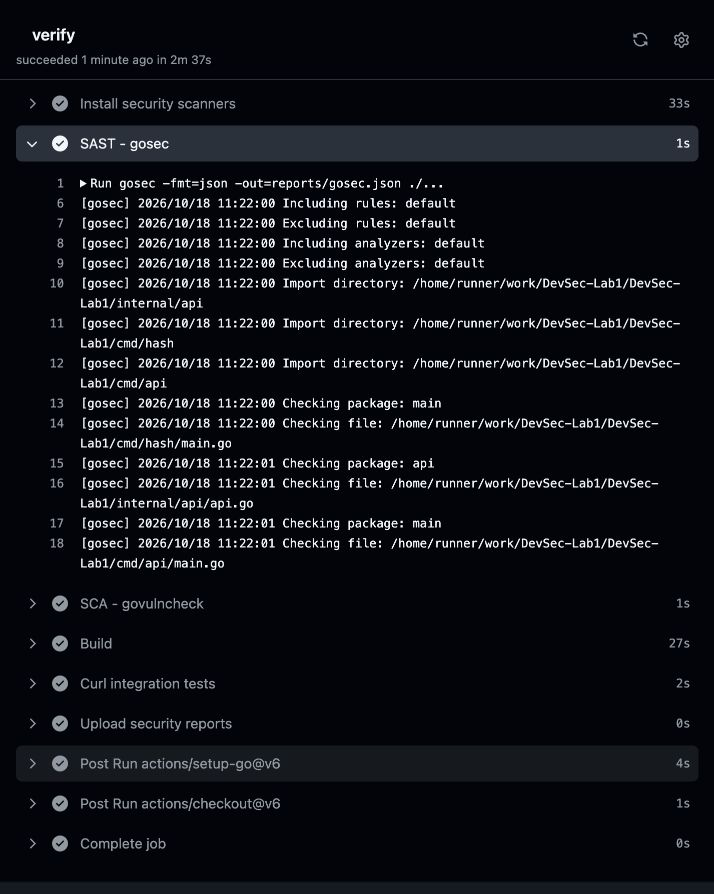
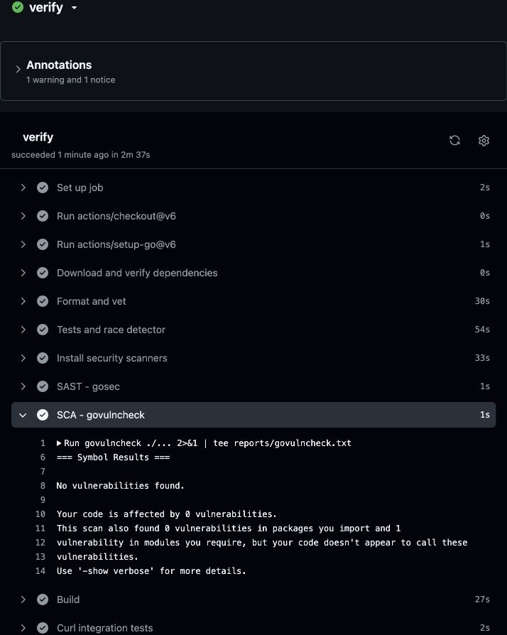
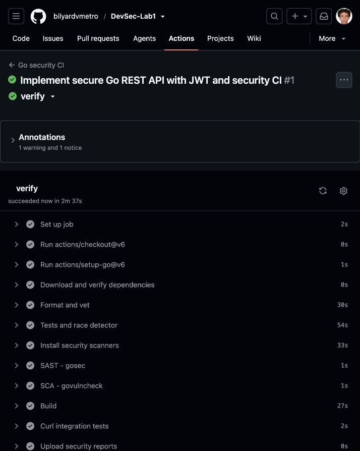

# Лабораторная работа 1 — защищённый REST API

**Назначение** — учебный REST API личных заметок на Go. Код: https://github.com/bilyardvmetro/DevSec-Lab1.

**Стек** — Go 1.26.9, net/http, SQLite, golang-jwt/jwt/v5 и x/crypto/bcrypt. Версии зафиксированы в go.mod/go.sum.

**Требования** — Linux или macOS, Go и C-компилятор для SQLite; curl, OpenSSL и Python 3 для smoke-теста.

**Загрузка** — git clone https://github.com/bilyardvmetro/DevSec-Lab1.git; затем cd DevSec-Lab1 и go mod download.

**Сборка** — go build -o bin/hash ./cmd/hash и go build -o bin/api ./cmd/api.

**Настройка** — перед запуском задаются три переменные окружения:

**ADMIN_USERNAME** — логин начального пользователя, например student.

**ADMIN_PASSWORD_HASH** — bcrypt-хеш со стоимостью не ниже 12; утилита bin/hash читает пароль из stdin (12–72 байта).

**JWT_SECRET** — случайный ключ не короче 32 байт в Base64: export JWT_SECRET=$(openssl rand -base64 32).

**Запуск** — ./bin/api; по умолчанию адрес 127.0.0.1:8080. LISTEN_ADDR меняет loopback-адрес/порт. Создаётся lab.db.

**Методы API** — все тела запросов передаются как application/json; доступны:

**POST /auth/login** — username/password; при успехе 200 и access_token, token_type=Bearer, expires_in=900.

**GET /api/data** — с заголовком Authorization: Bearer <JWT>; ответ 200 и последние 100 своих заметок.

**POST /api/data** — с JWT и полями title/content; ответ 201 и объект id/title/content. Владелец берётся из токена.

**Пример чтения** — curl -i -H "Authorization: Bearer $TOKEN" http://127.0.0.1:8080/api/data. Без заголовка ответ 401.

**Пример создания** — curl -i -H "Authorization: Bearer $TOKEN" -H "Content-Type: application/json" -d '{"title":"Note","content":"Text"}' http://127.0.0.1:8080/api/data.

**Ограничения ввода** — title: 1–100 байт после TrimSpace; content: до 2000 байт; тело: до 4096 байт. Неизвестные поля и второй JSON запрещены.

**Коды ошибок** — 400: неверный JSON/поля; 401: нет доступа; 413: большое тело; 415: не JSON; 429: превышен лимит. Ошибка содержит поле error.

**SQLi** — запросы к SQLite используют параметры ?. Значения не конкатенируются с SQL. SQL-подобный текст остаётся данными.

**XSS** — title/content проходят html.EscapeString при чтении и создании. JSON дополнительно экранирует HTML-символы; клиенту нужен textContent.

**Пароли** — в SQLite хранится только bcrypt-хеш с солью и cost=12. Неизвестный пользователь также проходит bcrypt-проверку; ошибки входа одинаковы.

**JWT** — HS256 с явным списком допустимых алгоритмов; обязательный exp, проверка iss/aud, nbf/iat при наличии и существования sub.

**Изоляция** — owner_id берётся из проверенного JWT, чтение фильтруется по владельцу. Передать owner_id через JSON нельзя.

**HTTP-защита** — application/json, nosniff, CSP default-src 'none' и Cache-Control: no-store; таймауты и ограничение заголовков 8192 байтами.

**Лимит входа** — 20 запросов в минуту на процесс, затем 429 и Retry-After. Глобальный лимит учебный; в production нужен лимит по аккаунту/IP.

**Секреты** — .env и база исключены из git. Сервер не пишет пароли/JWT в журнал. umask 0077 ограничивает права новых файлов.

**TLS** — приложение слушает только loopback. Для удалённого доступа необходим HTTPS reverse proxy. Payload JWT подписан, но не зашифрован.

**Тесты** — go test -race -cover -v ./... и go vet ./...; проверяются SQLi, XSS, JWT, чужие данные, лимиты и валидация.

**Curl-проверка** — bash scripts/smoke.sh запускает временный сервер со случайными секретами, выполняет запросы и удаляет временную базу.

**SAST** — go install github.com/securego/gosec/v2/cmd/gosec@v2.29.0; затем gosec -fmt=json -out=gosec.json ./... .

**SCA** — go install golang.org/x/vuln/cmd/govulncheck@v1.9.0; затем govulncheck ./... . Проверка использует базу vuln.go.dev.

**CI/CD** — .github/workflows/ci.yml запускается на push, pull_request и вручную: зависимости, gofmt/vet, race-тесты, SAST, SCA, сборка и curl.

**Отчёты CI** — artifact security-reports хранится 30 дней, включая неуспешные запуски. Ошибка сканера блокирует успех pipeline.

**Результаты** — gosec: 0 замечаний; govulncheck: 0 затронутых вызовов и пакетов. GO-2026-5932 относится к неимпортируемому OpenPGP в x/crypto.

**Границы решения** — нет refresh/отзыва JWT, MFA, регистрации, распределённого rate limit и автоматического развёртывания. Чистый скан не гарантирует полной безопасности.

**Инструкции и доказательства** — подробные команды находятся в docs/USAGE.md; логи и снимки Actions — в docs/evidence. Запуски: https://github.com/bilyardvmetro/DevSec-Lab1/actions.

## Скриншоты GitHub Actions

